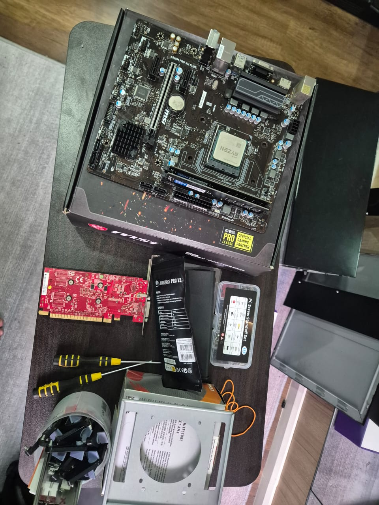
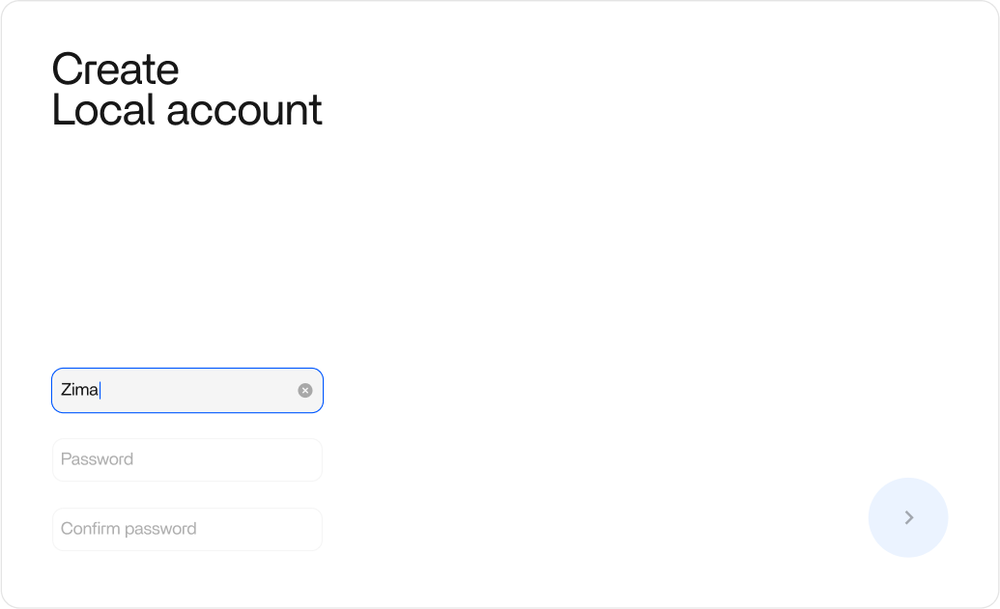
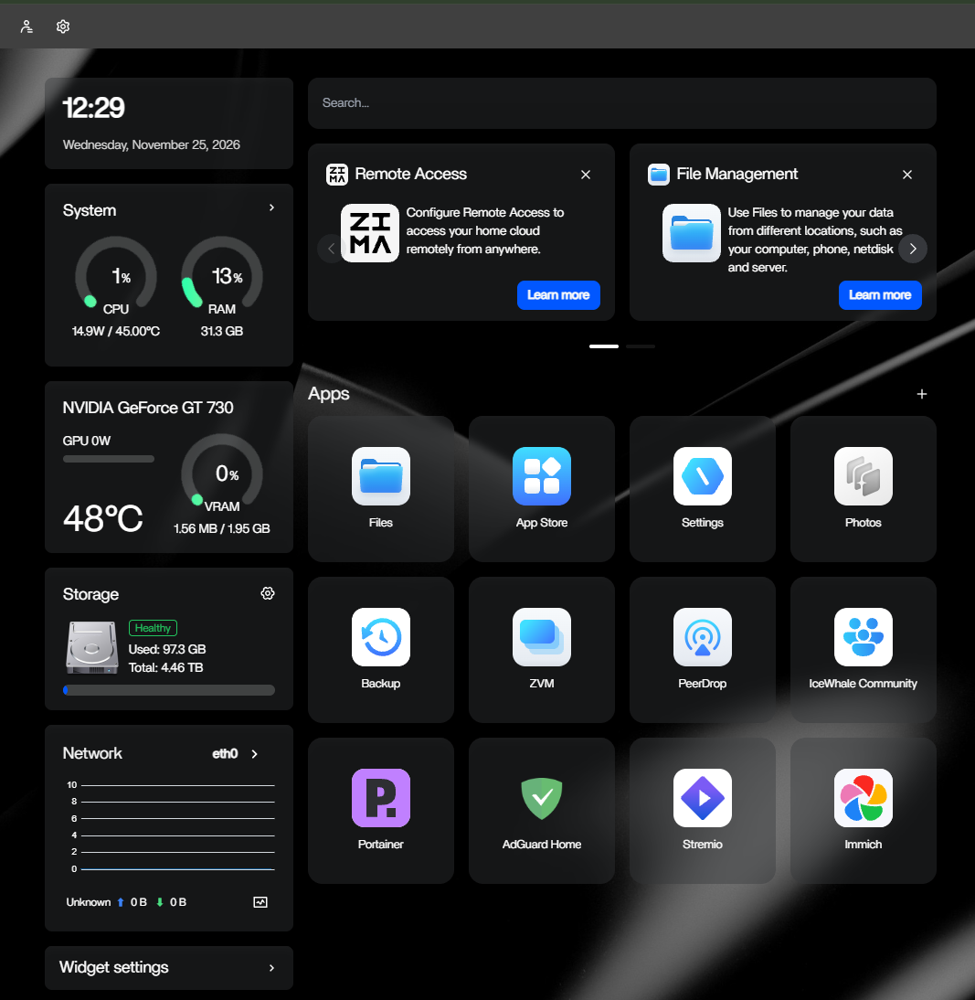

# ZimaOS-Homelab-Project
Turning unused PC hardware into a self-hosted homelab for learning infrastructure, networking, containerization and DevOps practices.

## 📑 Table of Contents

- [Project Overview](#-personal-homelab--self-hosted-infrastructure)
- [Project Objectives](#-project-objectives)
- [Hardware Specifications](#-hardware-specifications)
- [Build Process](#-homelab-build-process)
- [ZimaOS Installation & Initial Setup](#-zimaos-installation--initial-setup)
- [Infrastructure & Technology Stack](#-infrastructure--technology-stack)
- [Hosted Services](#-hosted-services)
- [Networking & Connectivity](#-networking--connectivity)
- [Containerization](#-containerization--service-management)
- [Skills & Learning Outcomes](#-skills--learning-outcomes)
- [Future Improvements](#-future-improvements)

# 🖥️ Personal Homelab & Self-Hosted Infrastructure

A personal homelab built for learning, experimentation, and exploring real-world infrastructure and DevOps practices.

This project serves as a hands-on environment for understanding server administration, containerization, networking, storage management, and self-hosted services. It also acts as a practical portfolio project to demonstrate infrastructure and DevOps-related skills.

## 🎯 Project Objectives

- Gain practical experience in Linux and server administration.
- Learn containerization and service deployment using Docker.
- Understand networking, port forwarding, and remote service accessibility.
- Explore NAS architecture and centralized storage management.
- Deploy and maintain self-hosted applications.
- Experiment with infrastructure management and service reliability.
- Develop practical DevOps skills through continuous experimentation.

## 🖥️ Hardware Specifications

| Component | Specification |
|---|---|
| CPU | AMD Ryzen 5 3600 |
| Motherboard | MSI A320M PRO-VH PLUS |
| Memory | 32GB DDR4 (2 × 16GB) |
| GPU | NVIDIA GeForce GT 730 |
| Operating System | ZimaOS |
| Primary Storage | 500GB SSD |
| Additional Storage | 4TB HDD storage for NAS |
| Power Supply | 80 PLUS Gold (exact model unspecified) |

## 🔨 Homelab Build Process

1. Acquiring the PC Case

Purchased a second-hand PC case through Carousell, featuring 3.5-inch and 5.25-inch drive bays to accommodate multiple storage drives for the NAS setup.

  

2. Hardware Assembly

Assembled the system using a combination of spare components (Motherboard, HDD), unused parts from friends (GPU, PSU & CPU), and newly purchased components sourced online (RAM, SSD).

  

3. First Startup

Successfully completed the initial hardware assembly and powered on the system for the first time, marking the beginning of the homelab setup.

  

> **Disclaimer:** The motherboard BIOS must be updated to a version that supports 3rd Gen AMD Ryzen processors before installing the Ryzen 5 3600. The specific MSI motherboard used in this build may not ship with a Ryzen 3000-ready BIOS.

> *Lesson learned: Always check BIOS compatibility before assuming the PC will POST. Ask me how I know.*

## 🐧 ZimaOS Installation & Initial Setup

After completing the hardware assembly, the next step was installing ZimaOS to transform the repurposed PC into a home server.

### 1. Initial ZimaOS Setup

Installed ZimaOS on the primary 500GB SSD and completed the initial system configuration.

### 2. First Login & Dashboard

Accessed the ZimaOS web interface for the first time to explore the system dashboard and available server management features.

  

  

## ⚙️ Infrastructure & Technology Stack

| Technology | Purpose |
|---|---|
| ZimaOS | Server operating system and management |
| Portainer (Docker) | Containerization and application deployment |
| NAS | Centralized network storage |
| Networking | Router configuration, port forwarding and connectivity |
| Self-hosted applications | Hosting and managing personal services |

## 🚀 Hosted Services

### 1. Immich
Self-hosted photo and video management platform.

- Personal photo and video library.
- Centralized media storage.
- Learning application deployment and persistent storage management.

### 2. Arma 3 Dedicated Server
A self-hosted multiplayer game server.

- Dedicated game server deployment.
- Docker-based server management.
- SteamCMD integration.
- Mod and mission management.
- Network port configuration for multiplayer connectivity.

### 3. NAS (Network Attached Storage)
Centralized storage environment for personal files and data.

- Network-accessible storage.
- Centralized file management.
- HDD-based storage.
- Separation of operating system and data storage.

### 4. Stremio
Media streaming application.

- Personal media streaming environment.
- Exploration of media service configuration.
- Learning application deployment and service accessibility.

### 5. Portainer
- **Purpose:** Docker container management and monitoring.
- **Usage:** Provides a web-based interface to manage containers, images, volumes and networks.
- **Learning Focus:** Container lifecycle management, Docker administration and service deployment.

### 6. AdGuard Home
- Configured DNS-based ad and tracker blocking.
- Explored network-wide DNS filtering for connected devices.
- Learned about DNS resolution, upstream DNS servers and network-level filtering.

## 🌐 Networking & Connectivity

The homelab uses a home network environment to provide connectivity between hosted services and external clients.

Areas explored include:

- Router and mesh Wi-Fi configuration.
- Port forwarding for externally accessible services.
- Internal and external network connectivity.
- TCP/UDP port configuration.
- Network troubleshooting.
- Understanding DNS and network-level filtering.

## 🐳 Containerization & Service Management

Docker is used to run and manage containerized applications within the homelab.

This provides hands-on experience with:

- Container deployment and configuration.
- Container lifecycle management.
- Persistent volumes and data storage.
- Port mapping and network configuration.
- Container logs and troubleshooting.
- Managing multiple services on a single host.

## 📚 Skills & Learning Outcomes

This homelab is an ongoing learning project focused on developing practical infrastructure knowledge.

**Infrastructure & Systems Administration**
- Server setup and maintenance.
- Operating system management.
- Hardware and resource utilization.
- Storage administration.

**DevOps & Containerization**
- Docker and container management.
- Application deployment.
- Service configuration.
- Troubleshooting and log analysis.

**Networking**
- TCP/UDP networking fundamentals.
- Port forwarding.
- Router and mesh network configuration.
- DNS and network troubleshooting.

**Self-Hosting**
- Deploying and maintaining personal services.
- Managing persistent application data.
- Running multiple services on shared infrastructure.

## 🔧 Future Improvements

The homelab is continuously evolving. Planned improvements include:

- [ ] Implement VLANs for network segmentation.
- [ ] Set up centralized monitoring and resource tracking.
- [ ] Implement automated backups.
- [ ] Explore reverse proxy configuration.
- [ ] Implement secure remote access using VPN.
- [ ] Explore infrastructure automation.
- [ ] Experiment with CI/CD pipelines.
- [ ] Improve container orchestration and management.
- [ ] Implement centralized logging.

## 📌 Project Philosophy

This homelab is primarily a personal learning environment rather than a production enterprise infrastructure.

The goal is to gain practical experience by building, deploying, breaking, troubleshooting, and improving real services.

It provides an opportunity to experiment with technologies and infrastructure concepts that are commonly encountered in system administration, cloud engineering, and DevOps roles.

---

**Status:** Active / Ongoing Development

**Purpose:** Personal Learning & DevOps Portfolio
